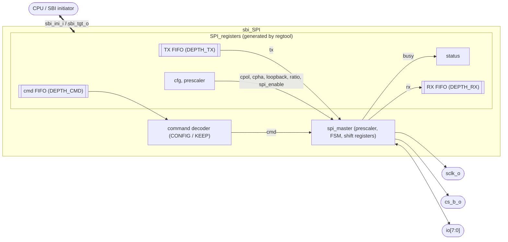
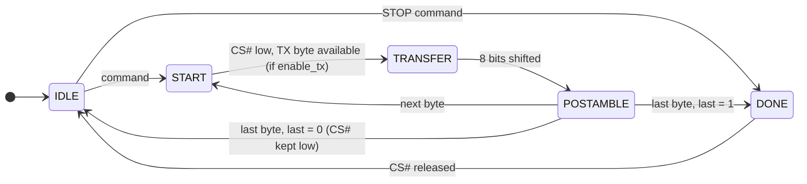

<!--
  README MODEL (common to every Asylum IP, keep the same headings)
  ----------------------------------------------------------------
  Regenerate from the sources, never from the previous README text alone:
    hdl/*.vhd (entities, generics, ports), hdl/csr/*.hjson (register map),
    <IP>.core (VLNV, targets, depends), mk/targets.txt, sim/, syn/, esw/.
  Sections, in this order:
    badges / title + one-line pitch / Overview / Features / Block Diagram /
    Getting Started / Hardware Interfaces / Configuration /
    Theory of Operation / Registers / Programmer's Guide /
    Design Verification / Dependencies and Related IPs / License
  Rules:
    - English, short and factual: every statement backed by the sources.
    - No VLNV line: the version badge shows it.
    - Block diagram and FSM in Mermaid (rendered by GitHub).
    - Registers: link to the generated hdl/csr/<X>_csr.md, never copy the tables.
    - Tables: Configuration = Name|Type|Default|Description,
      Hardware Interfaces = Name|Direction|Type|Description, grouped by interface.
    - A section with nothing to say is one line ("This IP has no
      software-visible registers."), never removed.
-->
[](https://github.com/deuskane/asylum-communication-spi/actions/workflows/ci.yml)
[](https://github.com/deuskane/asylum-communication-spi/tags)
[](LICENSE)

# SPI master

**A small, readable SPI master in VHDL: single, dual, quad and octal SPI, command FIFO, verified with UVVM against eight SPI flash models.**

Part of the [Asylum project](https://github.com/deuskane/asylum-project), a collection of small FPGA IP cores written to be read and learned from.

## Table of Contents

1. [Overview](#overview)
2. [Features](#features)
3. [Block Diagram](#block-diagram)
4. [Getting Started](#getting-started)
5. [Hardware Interfaces](#hardware-interfaces)
6. [Configuration](#configuration)
7. [Theory of Operation](#theory-of-operation)
8. [Registers](#registers)
9. [Programmer's Guide](#programmers-guide)
10. [Design Verification](#design-verification)
11. [Dependencies and Related IPs](#dependencies-and-related-ips)
12. [License](#license)

## Overview

This IP lets a CPU talk to SPI devices, typically a SPI NOR flash. Software drives it through four 8-bit registers on the SBI bus (the simple bus of Asylum):

- the bytes to send are written to a TX FIFO,
- each transfer is described by a command (byte count, lane width, TX/RX enable, keep or release CS#) written to a command FIFO,
- the received bytes are read back from an RX FIFO.

The protocol engine, `spi_master`, has AXI-Stream-like valid/ready interfaces and can also be used on its own, without the registers.

## Features

- SPI master, modes 0 to 3 (CPOL / CPHA), MSB first
- Single, dual, quad and octal data lanes, selected per command
- SCLK prescaler: `f_sclk = f_clk / (2 x (ratio + 1))`, fixed or software-writable
- Command FIFO: up to 4 bytes per command, or 64 bytes with a `KEEP` command; CS# kept low between commands to build a flash transaction (opcode, address, dummy, data)
- Configurable FIFO depths (0 = no storage, the CPU writes straight into the SPI master)
- Status register: FIFO empty / full flags and busy
- Optional WP# / HOLD# handling for quad flashes, minimum CS# high time (flash tSHSL)
- Optional late RX sampling with input registers for slow pads or fast SCLK
- Internal loopback (MOSI to MISO) for self-test
- Output enables on every pad for tri-state IO buffers
- Simulation only: dump of the CMD / TX / RX traffic to text files

## Block Diagram



A drawio version of this diagram is kept in [doc/SPI.drawio](doc/SPI.drawio).

## Getting Started

The cores of the Asylum IPs are published in the FuseSoC library [asylum-cores](https://github.com/deuskane/asylum-cores) (with the UVVM and flash model cores used by the testbenches):

```bash
pip install fusesoc
fusesoc library add https://github.com/deuskane/asylum-cores
fusesoc run --target sim_basic asylum:communication:SPI      # needs GHDL
```

To use the IP in your design, add `asylum:communication:SPI` to the `depend` list of your core and instantiate `sbi_SPI` (library `asylum`):

```vhdl
library asylum;
use     asylum.sbi_pkg.all;
use     asylum.spi_pkg.all;

  ins_spi : sbi_SPI
    generic map
    ( NAME                  => "SPI0"
     ,USER_DEFINE_PRESCALER => true
     ,PRESCALER_RATIO       => x"04"    -- 10 MHz SCLK from 100 MHz
     ,DEPTH_CMD             => 4
     ,DEPTH_TX              => 4
     ,DEPTH_RX              => 4
     ,HANDLE_HOLD_WP        => true
    )
    port map
    ( clk_i     => clk
     ,arst_b_i  => arst_b
     ,sbi_ini_i => sbi_ini       -- 2 address bits, 8-bit data
     ,sbi_tgt_o => sbi_tgt
     ,sclk_o    => spi_sclk
     ,sclk_oe_o => spi_sclk_oe
     ,cs_b_o    => spi_cs_b
     ,cs_b_oe_o => spi_cs_b_oe
     ,io_o      => spi_io_o
     ,io_i      => spi_io_i
     ,io_oe_o   => spi_io_oe
    );
```

[PicoSoC](https://github.com/deuskane/asylum-soc-picosoc) is a complete example: it connects this IP to a CPU and a SPI flash, with the software driver [esw/include/spi.h](https://github.com/deuskane/asylum-soc-picosoc/blob/main/esw/include/spi.h).

## Hardware Interfaces

Top-level entity: **`sbi_SPI`** ([hdl/sbi_SPI.vhd](hdl/sbi_SPI.vhd)), component in `asylum.spi_pkg`.

### Clock and Reset

| Name | Direction | Type | Description |
|------|-----------|------|-------------|
| `clk_i` | in | std_logic | System clock, the only clock of the IP |
| `arst_b_i` | in | std_logic | Asynchronous reset, active low |

### Bus (SBI)

| Name | Direction | Type | Description |
|------|-----------|------|-------------|
| `sbi_ini_i` | in | sbi_ini_t | Request from the initiator (`cs`, `re`, `we`, `addr`, `wdata`); 2 address bits, 8-bit data |
| `sbi_tgt_o` | out | sbi_tgt_t | Response to the initiator (`ready`, `rdata`, `info`) |

### SPI

| Name | Direction | Type | Description |
|------|-----------|------|-------------|
| `sclk_o` | out | std_logic | SPI clock |
| `sclk_oe_o` | out | std_logic | SPI clock output enable |
| `cs_b_o` | out | std_logic | Chip select, active low |
| `cs_b_oe_o` | out | std_logic | Chip select output enable |
| `io_o` | out | std_logic_vector(7 downto 0) | Data lanes: 0 = MOSI, 1 = MISO, 2 = WP#, 3 = HOLD# in single mode; lanes 0..1 / 0..3 / 0..7 in dual / quad / octal mode |
| `io_i` | in | std_logic_vector(7 downto 0) | Data lanes input, same mapping (MISO = `io_i(1)` in single mode) |
| `io_oe_o` | out | std_logic_vector(7 downto 0) | Per-lane output enable |

The pads are not instantiated in the IP: connect `*_o`, `*_oe_o` and `io_i` to IO buffers at the FPGA top level.

<details>
<summary><b>spi_master</b>: protocol engine, for a standalone use without the registers</summary>

[hdl/spi_master.vhd](hdl/spi_master.vhd), component in `asylum.spi_pkg`. Generics: `PRESCALER_WIDTH` (8), `HANDLE_HOLD_WP`, `CS_HIGH_MIN_CYCLES`, `RX_LATE_SAMPLE` (see [Configuration](#configuration)).

| Name | Direction | Type | Description |
|------|-----------|------|-------------|
| `clk_i` | in | std_logic | System clock |
| `arst_b_i` | in | std_logic | Asynchronous reset, active low (`cfg.spi_enable` in `sbi_SPI`) |
| `tx_tvalid_i` / `tx_tready_o` / `tx_tdata_i` | in / out / in | std_logic / std_logic / std_logic_vector(7 downto 0) | Bytes to send |
| `rx_tvalid_o` / `rx_tready_i` / `rx_tdata_o` | out / in / out | std_logic / std_logic / std_logic_vector(7 downto 0) | Received bytes |
| `cmd_tvalid_i` / `cmd_tready_o` | in / out | std_logic | Command handshake |
| `cmd_tlast_i` | in | std_logic | 1: release CS# at the end of the command |
| `cmd_keep_i` | in | std_logic (default `'0'`) | 1: `KEEP` command, no STOP decoding |
| `cmd_enable_rx_i` | in | std_logic | 1: push the received bytes to RX |
| `cmd_enable_tx_i` | in | std_logic | 1: pop the TX bytes and drive the data lanes |
| `cmd_nb_bytes_i` | in | std_logic_vector (unconstrained) | Number of bytes minus one |
| `cmd_size_i` | in | std_logic_vector (unconstrained, 2 bits used) | 0: single, 1: dual, 2: quad, 3: octal |
| `cfg_cpol_i` / `cfg_cpha_i` | in | std_logic | SPI mode |
| `cfg_prescaler_ratio_i` | in | std_logic_vector(PRESCALER_WIDTH-1 downto 0) | Prescaler ratio |
| `cfg_loopback_i` | in | std_logic | 1: MISO internally looped back from MOSI |
| `sclk_o`, `sclk_oe_o`, `cs_b_o`, `cs_b_oe_o`, `io_o`, `io_i`, `io_oe_o` | | | Same as `sbi_SPI` |
| `busy_o` | out | std_logic | 1: transaction in progress (FSM not idle or CS# active) |

</details>

## Configuration

Generics of `sbi_SPI`:

| Name | Type | Default | Description |
|------|------|---------|-------------|
| `NAME` | string | `""` | Instance name, visible in `sbi_tgt_o.info` |
| `USER_DEFINE_PRESCALER` | boolean | *(none)* | `true`: the `prescaler` register is software-writable; `false`: the ratio is fixed to `PRESCALER_RATIO` |
| `PRESCALER_RATIO` | std_logic_vector(7 downto 0) | *(none)* | Reset (or fixed) value of the prescaler ratio |
| `DEPTH_CMD` | natural | `0` | Depth of the command FIFO (0 = no FIFO) |
| `DEPTH_TX` | natural | `0` | Depth of the TX FIFO (0 = no FIFO) |
| `DEPTH_RX` | natural | `0` | Depth of the RX FIFO (0 = no FIFO) |
| `HANDLE_HOLD_WP` | boolean | `false` | `true`: `io(2)` (WP#) and `io(3)` (HOLD#) are driven high (inactive) except when a quad or octal command uses them as data lanes |
| `CS_HIGH_MIN_CYCLES` | natural | `0` | Minimum number of `clk_i` cycles with CS# high between two transactions (flash tSHSL), e.g. 5 for 100 ns at 50 MHz. CS# always stays high at least one SCLK period |
| `RX_LATE_SAMPLE` | boolean | `false` | `true`: `io_i` goes through input registers and is sampled one SCLK period after the sample edge, see [Timing](#timing) |
| `FILENAME_CMD` / `FILENAME_TX` / `FILENAME_RX` | string | `"dump_spi_cmd.txt"` / `"dump_spi_tx.txt"` / `"dump_spi_rx.txt"` | Simulation only: dump files of the accepted commands, sent and received bytes |

The FIFO depths set most of the area of the IP.

## Theory of Operation

### Hierarchy

| File | Unit | Role |
|------|------|------|
| [hdl/sbi_SPI.vhd](hdl/sbi_SPI.vhd) | `sbi_SPI` | Top level: registers, command decoder, `spi_master`, simulation dumps |
| [hdl/spi_master.vhd](hdl/spi_master.vhd) | `spi_master` | SPI protocol engine: prescaler, FSM, shift registers |
| [hdl/spi_pkg.vhd](hdl/spi_pkg.vhd) | `spi_pkg` | Components, IO lane indexes (`SPI_IO_MOSI`, `SPI_IO_MISO`, `SPI_IO_WP_B`, `SPI_IO_HOLD_B`) |
| `hdl/csr/SPI_csr.vhd` | `SPI_registers` | Register bank and FIFOs, generated by regtool from [hdl/csr/SPI.hjson](hdl/csr/SPI.hjson) |

### Data path

The `data` register is a bidirectional FIFO register: a write pushes a byte in the TX FIFO, a read pops a byte from the RX FIFO. `cmd` is a write-only FIFO register. Both are *blocking*: an access waits (holds the bus) until the FIFO can accept or provide the data. The FIFOs talk to `spi_master` with valid/ready handshakes, so the master simply stops when it has no TX byte to send or no room for a received byte.

### Commands

A command describes up to 4 bytes (`CONFIG`) or up to 64 bytes (`KEEP`):

- `cmd.cfg = CONFIG`: the command carries `size`, `enable_rx`, `enable_tx`, `last` and a 2-bit byte count `nb_bytes` (N+1 bytes). The decoder of `sbi_SPI` saves `size` / `enable_*`.
- `cmd.cfg = KEEP`: the saved `size` / `enable_*` are reused, and the 6 low bits of the command (`enable_tx & enable_rx & size & nb_bytes`) become a 6-bit byte count.
- `last = 1` releases CS# at the end of the command; `last = 0` keeps CS# low, so the next command continues the same transaction.
- STOP: a `CONFIG` command with `last = 1`, `enable_rx = 0` and `enable_tx = 0` transfers nothing and only releases CS#.

A flash read is therefore: `CONFIG` command "1 byte TX, keep CS#" (opcode), `CONFIG` "3 bytes TX, keep CS#" (address), `CONFIG` or `KEEP` "N bytes RX, last".

### spi_master FSM



- **IDLE**: waits for a command. CS# is high, or still low after a command with `last = 0`.
- **START**: asserts CS# (after the CS# high guard `CS_HIGH_MIN_CYCLES` for a new transaction), enables the needed lanes and waits for a TX byte when `enable_tx = 1`.
- **TRANSFER**: shifts 1, 2, 4 or 8 bits per SCLK period according to `size`, MSB first.
- **POSTAMBLE**: pushes the received byte to RX (when `enable_rx = 1`, waiting if RX is full), then next byte or end of command.
- **DONE**: releases CS#.

### SCLK and SPI modes

The prescaler is free-running: `f_sclk = f_clk / (2 x (ratio + 1))`; 100 MHz with `ratio = 4` gives 10 MHz. SCLK is generated from `clk_i`, there is no second clock domain.

| Mode | CPOL | CPHA | SCLK idle | Sample on |
|------|------|------|-----------|-----------|
| 0 | 0 | 0 | low | leading edge |
| 1 | 0 | 1 | low | trailing edge |
| 2 | 1 | 0 | high | leading edge |
| 3 | 1 | 1 | high | trailing edge |

### Enable and abort

`cfg.spi_enable` is the reset of `spi_master`. Writing 0 aborts a transfer in progress: CS# is driven high and SCLK to CPOL, the commands and TX bytes in the FIFOs (or written while disabled) are dropped; the received bytes stay in the RX FIFO.

### Timing

The SPI signals are not retimed by a PLL: the round trip SCLK out, flash, data in must fit in the sampling window.

- `RX_LATE_SAMPLE = false`: `(ratio + 1) x T_clk >= t_co(SCLK) + t_pad_out + tV(flash) + t_pad_in + t_route + t_setup`. With `ratio = 0` at 50 MHz the whole round trip has 20 ns.
- `RX_LATE_SAMPLE = true`: `io_i` is captured by a free-running input register (to place in the IOB) and sampled on the next shift edge: `2 x (ratio + 1) x T_clk >= t_co(SCLK) + t_pad_out + tV(flash) + t_pad_in + t_setup(IOB)`. With CPHA = 1 and a small `ratio`, a gap of up to one SCLK period may appear between bytes.
- Constrain `io_i` with an input delay relative to SCLK matching this window and choose the minimal `ratio` accordingly. `sclk_o` is `sclk_r xor cfg.cpol`: it does not glitch (CPOL is static during a transfer), but it is not an output register.

## Registers

Four 8-bit registers (2 address bits): `data` (0x0), `cmd` (0x1, write) / `status` (0x1, read), `cfg` (0x2), `prescaler` (0x3).

- Register documentation: **[hdl/csr/SPI_csr.md](hdl/csr/SPI_csr.md)**
- C header: [hdl/csr/SPI_csr.h](hdl/csr/SPI_csr.h)
- Source: [hdl/csr/SPI.hjson](hdl/csr/SPI.hjson) (regtool)

## Programmer's Guide

### Initialization

1. Write `cfg` with `spi_enable = 0` and the wanted `cpol`, `cpha`, `loopback`: changing the mode while enabled could create a spurious SCLK edge.
2. Write `prescaler.ratio` (only when `USER_DEFINE_PRESCALER = true`).
3. Write `cfg` again with `spi_enable = 1`.

### Transfers

1. Write the commands to `cmd` and the bytes to send to `data`, in any order.
2. Read the received bytes from `data`.
3. Before changing `cfg` or `prescaler`, wait for `status.busy = 0` (all commands done, CS# released).

### Never stall the bus

`data` and `cmd` are blocking: a read of an empty RX FIFO or a write to a full FIFO holds the bus (and the CPU) until the SPI master moves. `status` is never blocking:

- read `data` only when `status.rx_empty = 0`;
- with FIFOs (`DEPTH_* > 0`), write `data` when `status.tx_full = 0` and `cmd` when `status.cmd_full = 0`;
- with a depth of 0, `tx_full` / `cmd_full` read 1 outside the handshake: the write simply completes when the master takes the byte or the command;
- the master stops on a full RX FIFO: for a long full-duplex command, interleave the writes of `data` and the reads of `data` instead of writing all the TX bytes first (the bus blocks once the command is longer than `DEPTH_TX + DEPTH_RX + 2` bytes).

### Example: read the JEDEC ID of a SPI flash

`reg_wr` / `reg_rd` are the 8-bit register accesses of your CPU (`PORT_WR` / `PORT_RD` in PicoSoC).

```c
#include "SPI_csr.h"

void spi_init(void)
{
  reg_wr(SPI_CFG, 0);                          // disabled, mode 0
  reg_wr(SPI_PRESCALER, 4);                    // f_sclk = f_clk / 10
  reg_wr(SPI_CFG, 1 << SPI_CFG_SPI_ENABLE);    // enabled
}

void flash_read_id(uint8_t id[3])
{
  // opcode 0x9F: 1 byte TX, CS# kept low
  reg_wr(SPI_CMD, SPI_CMD_CFG_CONFIG_RAW | SPI_CMD_SIZE_SINGLE_RAW |
                  SPI_CMD_ENABLE_TX_ENABLE_RAW | SPI_CMD_LAST_DISABLE_RAW |
                  ((1-1) << SPI_CMD_NB_BYTES));
  reg_wr(SPI_DATA, 0x9F);

  // 3 bytes RX, then CS# released
  reg_wr(SPI_CMD, SPI_CMD_CFG_CONFIG_RAW | SPI_CMD_SIZE_SINGLE_RAW |
                  SPI_CMD_ENABLE_RX_ENABLE_RAW | SPI_CMD_LAST_ENABLE_RAW |
                  ((3-1) << SPI_CMD_NB_BYTES));
  for (int i = 0; i < 3; i++) {
    while (reg_rd(SPI_STATUS) & (1 << SPI_STATUS_RX_EMPTY))
      ;                                        // wait without blocking the bus
    id[i] = reg_rd(SPI_DATA);
  }
}
```

For transfers longer than 4 bytes, send one `CONFIG` command then `KEEP` commands of up to 64 bytes (see `spi_cmd2` in the PicoSoC driver).

## Design Verification

### Testbenches

| File | DUT | Description |
|------|-----|-------------|
| [sim/basic/tb_SPI.vhd](sim/basic/tb_SPI.vhd) | `sbi_SPI` | Self-checking UVVM testbench with the SBI VIP and a SPI slave model in the bench. The slave checks MOSI, drives MISO or the data lanes according to CPOL/CPHA, and checks the SCLK idle level on the CS# edges. Scenarios: reset values; the 4 SPI modes with 4 prescalers (SCLK period checked), single 1 and 4 bytes, dual and quad TX and RX, commands chained without `last` then STOP; `KEEP` command (1 + 9 bytes); loopback; abort by `spi_enable = 0`; status flags and busy, master stalled by a full RX FIFO |
| [sim/models/tb_SPI.vhd](sim/models/tb_SPI.vhd) | `sbi_SPI` | UVVM testbench against a real SPI flash model (generic `MODEL`): Read (0x03), Fast Read (0x0B); on `s25fl512s` also dual and quad reads (0x3B, 0xBB, 0x6B, 0xEB, continuous 0xEB) |

Flash models in [models/](models/) (Free Model Foundry, core [SPI_models.core](SPI_models.core)): `at25df161`, `cy15b104qs`, `cy15v104qs`, `m25p40`, `m45pe80`, `s25fl064p`, `s25fl512s`, `s35hl256t`.

### Targets

| Target | Description |
|--------|-------------|
| `sim_basic` | `tb_SPI` with the slave model of the bench |
| `sim_basic_late` | Same with `RX_LATE_SAMPLE = true` and a slave output valid time (25 ns) longer than half a SCLK period |
| `sim_<model>` | Flash model testbench, one target per model (8 targets) |
| `lint_ghdl` | GHDL `-Wall` analysis and elaboration of [syn/sbi_SPI_wrapper.vhd](syn/sbi_SPI_wrapper.vhd) |
| `lint_ghdl_synth_<config>` | `ghdl --synth` check (no latch, synthesizable) for 5 generic configurations: `default`, `sim_basic`, `sim_models`, `fixed_prescaler`, `rx_late_sample` |

Every `sim_*` target is a job of the [GitHub CI](https://github.com/deuskane/asylum-communication-spi/actions/workflows/ci.yml), run in the [asylum-env](https://github.com/deuskane/asylum-ci) image (GHDL, FuseSoC, UVVM).

### How to Run

From a clone of [asylum-project](https://github.com/deuskane/asylum-project) (GHDL and FuseSoC installed, or in the asylum-env image):

```bash
make help                        # variables, rules and targets
make sim_basic                   # one target, log in log/
make nonreg_sim                  # every sim_* target
make nonreg_lint                 # every lint_* target
make TARGETS_FILTER=^sim_s nonreg_sim
```

Outside the CI, GHDL writes a waveform `dut.fst`, and `sbi_SPI` writes the dumps `dump_spi_cmd.txt`, `dump_spi_tx.txt`, `dump_spi_rx.txt`.

## Dependencies and Related IPs

| Core | Repository | Purpose |
|------|------------|---------|
| `asylum:utils:generators` | [asylum-utils-generators](https://github.com/deuskane/asylum-utils-generators) | regtool (register generator) and the CSR building blocks (`csr_reg`, `csr_fifo`) |
| `asylum:utils:pkg` | [asylum-utils-pkg](https://github.com/deuskane/asylum-utils-pkg) | Common packages (`sbi_pkg`, ...) |
| `asylum:utils:ghdl_synth` | [asylum-utils-generators](https://github.com/deuskane/asylum-utils-generators) | `ghdl --synth` check of the `lint_ghdl_synth_*` targets |
| `asylum:target:techmap` | [asylum-target-techmap](https://github.com/deuskane/asylum-target-techmap) | Technology cells, model testbench |
| `bitvis:verification:uvvm` | [UVVM](https://github.com/UVVM/UVVM) | Verification library and SBI VIP |
| `fmf:memory:flash_nor` | this repository | SPI flash models |

Used by [asylum-soc-picosoc](https://github.com/deuskane/asylum-soc-picosoc). Other communication IPs of Asylum: [I2C](https://github.com/deuskane/asylum-communication-i2c), [UART](https://github.com/deuskane/asylum-communication-uart). All the IPs: [asylum-project](https://github.com/deuskane/asylum-project).

## License

Apache License 2.0, see [LICENSE](LICENSE).

Exception: the SPI flash models in [models/](models/) come from the [Free Model Foundry](https://www.freemodelfoundry.com) and keep their own license, GPL-2.0 (see the header of each file). They are only used by the `sim_<model>` simulation targets and are not part of the IP.
